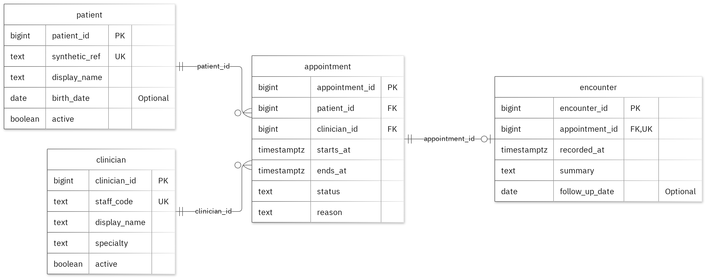

# MIT 8103 Advanced Database Systems

**Hospital / Clinic System** · Eno Eno · Student ID 301903633

## Case study

In my case study, I have created a database for a Hospital/Clinic System which includes tables: patient, clinician, appointment and encounter. This system allows the user to book and manage appointments in a clinic. The appointment can have encounters recorded and reports reviewed for appointments and encounters. The appointment date can be filtered in the database to compare with the synthetic rows.

## Portfolio 1: Database Design and Modelling

The database has been split into 4 tables. The primary key ensures each record can be identified, the foreign keys ensure the relationships remain intact. The checks ensure the business rules are adhered to. Only one appointment can be booked for a clinician at a certain start time (if it is booked or confirmed). Cancellations are not included due to the partial unique constraint. Normalisation examples show the sample data has been put into 1NF, 2NF and 3NF. All 13 invalid inserts (on purpose) were denied. This did not affect any of the sample data.

Figure 1. Tables, keys and relationships. PK: primary key; FK: foreign key; UK: unique value.

<!-- PAGE BREAK -->

## Portfolio 2: Query Processing and Optimisation

Three queries have been run using SQL. The join query returned 1 row. This included SYN-P-1001 and SYN-C-2001. The index comparison used 20,000 individual rows of performance data. The median lookup time reduced from 1.042ms to 0.179ms. The same records were returned in both stages. The plan produced used the new index. These times are for this lookup and environment.

## Portfolio 3: Transactions and Concurrency

A temporary counter was added to the appointment table. COMMIT, ROLLBACK and READ COMMITTED were tested. The uncommitted change was not visible to the other session. ROLLBACK reverted back to the previously committed value. Without locking the value increased by 2. Using SELECT FOR UPDATE caused Session B to wait for Session A. The final value was therefore 3. The helper is limited to this exercise only. The original business fields from the case have not changed.

## Portfolio 4: NoSQL and Advanced Data Models

The care_events table was used for the events within the case. Two sample events were inserted using MongoDB. The four queries returned the expected results. An invalid date type and duplicate event ID were not allowed due to the validation. The embedded snapshots mean related information is stored with the event. The details field may vary depending on the event type. These are fictional events. PostgreSQL still enforces its relational rules.

## Repository and evidence

https://github.com/DonWills001/Eno_Eno_301903633

The portfolio folders contain the SQL and JavaScript, explanations, query plans, result tables and screenshots.

<!-- PAGE BREAK -->

## Portfolio 5: Distributed and Cloud Database Exercise

Three members were proposed for the MongoDB replica set. These would be in separate failure zones. Primary elections, majority acknowledgement, secondary lag and trade-offs for sharding were discussed. Replication was used to ensure availability. Backups were used to help with recovery. Availability needs to be planned for PostgreSQL. This was the only option to discuss. There was no live replica set to test failover.

## Individual reflection

Separate tables were used for patient, clinician, appointment and encounter so that information could be stored without duplication. Only one appointment can be booked for a clinician at certain start time (if it is booked or confirmed). Cancellations are not included due to the partial unique constraint. The constraints were used to ensure that only one appointment can be booked for a clinician at certain start time, required values and that relationships are maintained. One issue that was highlighted was that both sessions can view the same value. By locking the row before reading the value will increase by both increments. The index comparison shows that I need to check the execution plan. This is because the same results can be achieved with different amounts of work done within the database.

## AI-use declaration

I used GitHub Copilot and the portfolio generator to help prepare the database model and scripts. The generator ran the PostgreSQL and MongoDB exercises, checked their outputs and captured the result images.  I remain responsible for checking and explaining the submitted work.

## References

- [PostgreSQL: constraints](https://www.postgresql.org/docs/17/ddl-constraints.html)
- [PostgreSQL: EXPLAIN](https://www.postgresql.org/docs/17/using-explain.html)
- [PostgreSQL: isolation](https://www.postgresql.org/docs/17/transaction-iso.html)
- [PostgreSQL: row locks](https://www.postgresql.org/docs/17/explicit-locking.html)
- [MongoDB: data modelling](https://www.mongodb.com/docs/manual/data-modeling/)
- [MongoDB: replication](https://www.mongodb.com/docs/manual/replication/)
- [MongoDB: sharding](https://www.mongodb.com/docs/manual/sharding/)
- [Mermaid: ER diagrams](https://mermaid.js.org/syntax/entityRelationshipDiagram.html)

